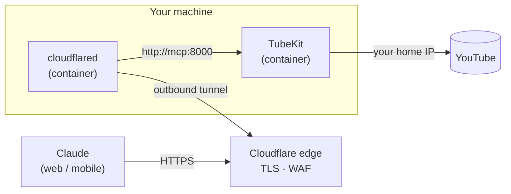

<div align="center">

# 🎬 TubeKit

**YouTube tools for Claude and any MCP client: list playlists, read transcripts, and find exactly *when* a topic comes up.**

[](https://github.com/harisharul/tubekit/actions/workflows/ci.yml)
[](https://www.python.org/)
[](https://modelcontextprotocol.io)
[](https://github.com/harisharul/tubekit/pkgs/container/tubekit)
[](https://github.com/yt-dlp/yt-dlp)

[Features](#-features) · [Quick start](#-quick-start) · [Tools](#-tools) · [Remote access](#-use-it-from-claudeai-web--mobile) · [Configuration](#%EF%B8%8F-configuration) · [Security](#-security) · [FAQ](#-faq)

</div>

---

> [!WARNING]
> **Run TubeKit on your own machine, not on a cloud server.**
> YouTube blocks most data-centre IP addresses (AWS, Azure, GCP and others) with *"Sign in to confirm you're not a bot"*. From a cloud server, transcript tools fail even though playlist listing still works. We tested this on Azure Container Apps: every request was refused.
> A **home or office internet connection** works. To reach your local server from claude.ai or your phone, use a tunnel ([see below](#-use-it-from-claudeai-web--mobile)) instead of hosting it in the cloud.

## ✨ Features

- 📋 **Playlist listing.** Get exactly the range you need (`start=4, end=10`) or filter by title, without pulling a 500-video list into the chat.
- 📝 **Transcripts, one page at a time.** Read a whole video in pages, or just one time window (`"10:00"`–`"15:00"`). The first page lists the video's chapters.
- 🔎 **Topic search with timestamps.** Ask *"where do they talk about loss functions?"*. Claude picks the keywords, TubeKit returns the time ranges, and you read only that part.
- 🪙 **Built to save tokens.** Compact text output, paging by default and server-side filtering. In our tests, a "where is X discussed?" question cost **about 600 tokens instead of about 16,000** for the full transcript.
- 🔐 **Hardened for exposure.** SSRF protection, input and size limits, Host-header checks and a non-root, read-only container. See [Security](#-security).
- 🔑 **No API key.** Uses [yt-dlp](https://github.com/yt-dlp/yt-dlp), with no Google Cloud project or quota.
- 🐳 **Runs anywhere you have Docker or Python:** Windows (incl. WSL), macOS or Linux, on amd64 and arm64.

## 💬 What it looks like

> **You:** In https://youtu.be/s2jm2Z22ibA, where does he talk about speech-to-text? Then explain that part.

Claude calls `search_transcript` with keywords it chose and gets back:

```text
Video: Coding Challenge 188: Voice Chatbot | 39:27 | id s2jm2Z22ibA | captions en-US (manual)
Keywords: "speech to text" 8, "Whisper" 10, "transcribe" 6, "transcription" 2, "STT" 0
Chapter matches: 00:35 Mapping out the pieces...; 02:44 Choosing the tools: Whisper and Kokoro TTS; ...
10 ranges (time order), top 10 of 15 by relevance:
1. [00:35-01:05] speech to text x3 | "...We need some system for speech to text. By speech to text, I mean..."
...
Read more: get_video_transcript(video="s2jm2Z22ibA", start_time="05:03", end_time="07:07")
```

…then reads just `05:03–07:07` and explains it.

## 🚀 Quick start

Choose the setup that matches your Claude app. All of them run TubeKit **on your machine**.

| Option | Best for | Needs |
|---|---|---|
| **A. uv (recommended)** | Claude Desktop, Claude Code | [uv](https://docs.astral.sh/uv/getting-started/installation/) |
| **B. Docker (stdio)** | Claude Desktop or Claude Code, without installing Python | [Docker](https://docs.docker.com/get-docker/) |
| **C. Docker and a tunnel** | **claude.ai on the web and the Claude mobile apps** | Docker, plus a free [Cloudflare](https://dash.cloudflare.com/sign-up) account and a domain |

### Option A: uv

**1. Install uv.** It installs Python 3.13 for you if needed.

macOS / Linux / WSL:

```bash
curl -LsSf https://astral.sh/uv/install.sh | sh
```

Windows (PowerShell):

```powershell
winget install --id astral-sh.uv -e
```

**2. Get TubeKit**

```bash
git clone https://github.com/harisharul/tubekit.git
```

```bash
cd tubekit && uv sync
```

**3. Connect your client**

<details open>
<summary><b>Claude Code</b></summary>

```bash
claude mcp add tubekit -- uv run --directory /absolute/path/to/tubekit tubekit-mcp
```

</details>

<details>
<summary><b>Claude Desktop</b></summary>

Open **Settings → Developer → Edit Config**, add the following, then restart Claude Desktop:

```json
{
  "mcpServers": {
    "tubekit": {
      "command": "uv",
      "args": ["run", "--directory", "/absolute/path/to/tubekit", "tubekit-mcp"]
    }
  }
}
```

On Windows, use a path like `C:\\Users\\you\\tubekit` (with double backslashes).

</details>

<details>
<summary><b>Other MCP clients</b></summary>

Run `uv run tubekit-mcp` from the project folder. It speaks MCP over **stdio** by default.

</details>

### Option B: Docker (stdio)

No clone needed. The client starts a container on demand from the published image:

```json
{
  "mcpServers": {
    "tubekit": {
      "command": "docker",
      "args": ["run", "-i", "--rm", "-e", "MCP_TRANSPORT=stdio", "ghcr.io/harisharul/tubekit:latest"]
    }
  }
}
```

For Claude Code:

```bash
claude mcp add tubekit -- docker run -i --rm -e MCP_TRANSPORT=stdio ghcr.io/harisharul/tubekit:latest
```

> [!TIP]
> Replace `latest` with a `sha-…` tag from the [package page](https://github.com/harisharul/tubekit/pkgs/container/tubekit) to pin an exact version.

### ✅ Try it

> *List videos 1–5 of playlist PLRqwX-V7Uu6ZiZxtDDRCi6uhfTH4FilpH*
>
> *What chapters does video s2jm2Z22ibA have? Summarise only the one about Whisper.*
>
> *Does https://youtu.be/s2jm2Z22ibA mention running models in the browser? Timestamps only.*

## 🧰 Tools

| Tool | What it does | Key parameters |
|---|---|---|
| `list_playlist_videos` | Lists videos as `position. title [id] duration`, 50 per call by default and 200 at most. Only the requested range is fetched from YouTube. | `playlist`, `start`, `end`, `title_filter` |
| `get_video_transcript` | Returns a transcript in pages of `max_chars`, or just a time window. The first page lists chapters, and each page says how to fetch the next one. | `video`, `language`, `start_time`, `end_time`, `offset`, `max_chars`, `include_timestamps` |
| `search_transcript` | Finds **when** topics are discussed. Claude passes the user's term plus synonyms. Returns ranked time ranges, hit counts, short quotes, chapter matches and keywords with zero hits. | `video`, `keywords`, `max_results`, `snippets` |

<details>
<summary><b>How the search works (no index, no AI model, nothing stored)</b></summary>

- Matching is case-insensitive and whole-word: `loss` doesn't match "glossary", but `function` matches "functions", and `cross entropy` matches "cross-entropy".
- Phrases split across two caption lines are still found.
- Hits less than 30 seconds apart merge into one range. Ranges with more *different* keywords rank higher.
- It works on Indian scripts too (Tamil, Hindi and others).
- The semantic part ("loss function" → "cost", "cross-entropy", "MSE") is done by Claude when it picks the keywords.

</details>

<details>
<summary><b>Token savings, measured on a 246-video playlist and a 39-minute video</b></summary>

| Request | Naive approach | TubeKit |
|---|---|---|
| Videos 4–10 of a playlist | ~28k tokens (whole list) | **~170** |
| Videos with "fractal" in the title | ~28k tokens | **~290** |
| One minute of transcript, with timestamps | ~20k tokens (whole video) | **~340** |
| "Where is X discussed?" | ~16k tokens (whole transcript) | **~600**, or ~170 without quotes |

</details>

## 🌐 Use it from claude.ai (web & mobile)

claude.ai can't start programs on your computer. It connects to MCP servers over **public HTTPS**, added as a [custom connector](https://support.claude.com/). The safe way to do that from home is a **Cloudflare Tunnel**: your machine opens an *outbound* connection, so there's **no port forwarding and no open firewall ports**, and YouTube still sees your home IP.



**1. Create a tunnel.** In the [Cloudflare dashboard](https://one.dash.cloudflare.com/), go to **Zero Trust → Networks → Tunnels → Create a tunnel → Cloudflared** and choose **Docker**. Copy only the token (`eyJ…`) from the command shown.

**2. Configure TubeKit**

```bash
git clone https://github.com/harisharul/tubekit.git && cd tubekit
```

```bash
cp .env.example .env
```

Fill in `.env`:

```dotenv
COMPOSE_PROFILES=cloudflare
TUNNEL_TOKEN=<your tunnel token>
MCP_ALLOWED_HOSTS=tubekit.example.com,localhost,127.0.0.1
MCP_SECRET_PATH=<output of: openssl rand -hex 24>
```

**3. Start it**

```bash
docker compose up -d --build
```

```bash
docker compose logs tunnel | grep -i registered
```

You should see 4 × `Registered tunnel connection`.

**4. Add a route.** In the tunnel's **Published application routes**:

| Field | Value |
|---|---|
| Hostname | `tubekit.example.com` (a domain on your Cloudflare account) |
| Service URL | `http://mcp:8000` |
| HTTP Host Header | *leave empty* |

**5. Connect Claude.** Go to **Settings → Connectors → Add custom connector** and enter:

```text
https://tubekit.example.com/mcp/<MCP_SECRET_PATH>
```

> [!IMPORTANT]
> **Keep `MCP_SECRET_PATH` set.** Your home IP is what makes transcripts work. An open endpoint would let anyone send their YouTube traffic through your connection, and could get your IP flagged too. Treat the full URL like a password.

<details>
<summary><b>Troubleshooting the tunnel</b></summary>

| Symptom | Fix |
|---|---|
| `502` | The route's Service URL must be `http://mcp:8000`. Check that `docker compose ps` shows `mcp` as healthy. |
| `421` | The Host header doesn't match. Add the hostname to `MCP_ALLOWED_HOSTS` and leave the route's HTTP Host Header empty. |
| `404` | The secret path in the URL doesn't match `.env`. |
| `530` / `1033` | The tunnel isn't connected. Check `docker compose logs tunnel` and the token. |

</details>

> [!TIP]
> **Auto-start on Windows/WSL:** enable systemd in WSL, install Docker Engine with `systemctl enable docker`, and add a Task Scheduler task that runs `wsl.exe -d Ubuntu --exec sleep infinity` at log-on. The containers use `restart: unless-stopped`, so they come back after every reboot.

## ⚙️ Configuration

All settings are environment variables, and all are optional.

| Variable | Default | Purpose |
|---|---|---|
| `MCP_TRANSPORT` | `stdio` (`http` in Docker) | `stdio` for desktop clients, `http` for remote use |
| `HOST` / `PORT` | `0.0.0.0` / `8000` | HTTP bind address. Use `127.0.0.1` when running outside Docker. |
| `MCP_SECRET_PATH` | — | Serve at `/mcp/<secret>` instead of `/mcp` |
| `MCP_ALLOWED_HOSTS` | — | Comma-separated `Host` headers to accept; other hosts get HTTP 421. **Set this behind any proxy or tunnel.** |
| `MCP_MAX_CONNECTIONS` | `100` | Concurrent HTTP connections before the server returns 503 |
| `TUBEKIT_MAX_CONCURRENCY` | `4` | Concurrent YouTube fetches |
| `YT_PROXY` | — | Outbound proxy for yt-dlp (`http://…` or `socks5://…`) |
| `YT_COOKIES_FILE` | — | A `cookies.txt` for YouTube sign-in checks. **Personal use only.** |

## 🔐 Security

TubeKit treats every tool argument as hostile, because MCP inputs come from an LLM that can be steered by users or by the content it reads.

| Threat | Mitigation |
|---|---|
| SSRF (fetching internal or metadata URLs) | Inputs are reduced to a YouTube ID and rebuilt as a `youtube.com` URL. yt-dlp is restricted to its YouTube extractors, and caption URLs must be HTTPS on a YouTube host. |
| Resource exhaustion | Length-capped inputs, 64 KB request bodies, caps on playlist position, filter scans and caption size, a concurrency limit and timeouts |
| Host-header attacks and DNS rebinding | `MCP_ALLOWED_HOSTS` (421 for other hosts). Requests with an untrusted browser `Origin` are rejected. |
| Secret leakage | Access logs are off, so the secret path never reaches logs. No credentials are needed. |
| Container compromise | Non-root user, read-only root filesystem, no Linux capabilities, base image pinned by digest, dependencies locked by hash |

Found a vulnerability? Please report it privately. See [SECURITY.md](SECURITY.md).

## ❓ FAQ

<details>
<summary><b>Transcripts fail with "YouTube is withholding them from this server"</b></summary>

YouTube is refusing your IP address with a bot check. This is expected on cloud servers and VPNs. Run TubeKit on a home or office connection. Check the server log: lines containing `Sign in to confirm you're not a bot` confirm it.

</details>

<details>
<summary><b>Can I host it publicly in the cloud?</b></summary>

The server works fine in the cloud; YouTube is the problem. Most cloud IP ranges are blocked from fetching captions. The only workarounds are a signed-in account (cookies) or a residential proxy. Never use cookies on a server other people use, because everyone would act as your Google account.

</details>

<details>
<summary><b>Which languages are supported?</b></summary>

Any language a video has captions in. Pass `language` (e.g. `en`, `hi`, `ta`). If the requested language is missing, the error lists the ones that exist. YouTube's auto-translated captions are heavily rate-limited, so prefer the video's original language.

</details>

<details>
<summary><b>It stopped working after a YouTube change</b></summary>

Update yt-dlp: run `uv lock --upgrade-package yt-dlp && uv sync`, or pull the latest Docker image. Dependabot keeps this repository current weekly.

</details>

## 🛠️ Development

```bash
uv sync
```

```bash
uv run pytest
```

The tests run offline. Every push to `main` runs CI and publishes a multi-arch image to GHCR, tagged `latest` and `sha-…`, with signed provenance and an SBOM.

<details>
<summary><b>Project layout</b></summary>

```text
src/tubekit_mcp/
├── server.py     # MCP tools, compact output formatting, HTTP server
└── youtube.py    # yt-dlp wrappers, input validation, search, limits
tests/            # offline unit and security regression tests
```

</details>

## 🙏 Acknowledgements

- [yt-dlp](https://github.com/yt-dlp/yt-dlp), which does the heavy lifting with YouTube
- [Model Context Protocol](https://modelcontextprotocol.io) and its [Python SDK](https://github.com/modelcontextprotocol/python-sdk)

---

<div align="center">

<sub>TubeKit is an independent open-source project and is not affiliated with or endorsed by YouTube or Google. Use it responsibly and in line with YouTube's Terms of Service.</sub>

</div>
